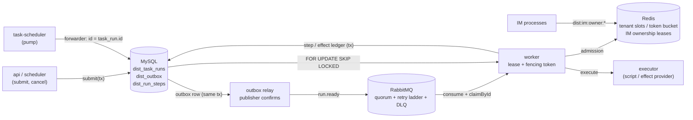

# 分布式执行子系统

## 总览



MySQL 是运行状态的唯一权威；Redis 只回答"现在能不能开始"和"谁持有这个 IM 凭证"；
RabbitMQ 只负责唤醒。丢掉任何一个外部系统都不会让已经写进 MySQL 的状态出错。

**每个阶段解决了什么**

- **Phase 1 租约 + fencing**：`FOR UPDATE SKIP LOCKED` 认领，`lease_token` 递增作为围栏，
  心跳续租、reaper 回收过期租约。不变式：同一 `lease_token` 只有一个写入者能提交，
  过期租约的持有者无法覆盖新持有者的结果。
- **Phase 2 事务性 outbox + MQ**：状态变更与 outbox 行在同一事务写，relay 用 publisher
  confirms 投递，消费端按 `dist_consumed_messages` 去重。不变式：MySQL 提交成功就一定
  会被投递（至少一次），重复投递不影响结果。
- **Phase 3 准入控制**：Redis 租户槽位与模型令牌桶（全部 Lua + `redis.call('TIME')`）。
  不变式：Redis 只做门控，丢失 Redis 只会减少并行度，不会让 run 卡住或重复执行。
- **Phase 4 持久化步骤与外部效应**：`intent → committed/unknown → needs_review` 的
  effect ledger，发送前写 `send_started_at`，客户端超时后先等结算窗口再判定。
  不变式：外部副作用最多发生一次；不确定的结果显式进入 `needs_review`，绝不静默重放。
- **Phase 5 定时任务接入**：SQLite 仍是任务结果/历史的权威，MySQL 只是派发信封
  （`idempotency_key = task_run.id`）。不变式：两条路径（legacy / dist）用同一行 SQLite
  记录、同一组认领条件、同一个执行租约，所以一个 run 不可能执行两次。
- **Phase 6 IM 连接持有权**：`dist:im:owner:{credential}` 租约 + fencing token，入站/出站
  逐条检查持有权。不变式：同一凭证在任意时刻最多一个进程回复；旧持有者既不能续租也不能
  删除新持有者的 key。

**故障 → 系统行为 → 验证**

| 故障                           | 系统行为                                           | 验证                                          |
| ------------------------------ | -------------------------------------------------- | --------------------------------------------- |
| worker 崩溃                    | 租约到期后 reaper 重新入队；已开始的执行不重放     | `dist:chaos`                                  |
| 僵尸 worker（进程冻结）        | 单调时钟自我围栏；IM 侧逐条入站门控丢弃            | `dist:chaos-im`（zombie）                     |
| MQ 重复投递                    | `dist_consumed_messages` 去重 + 认领幂等           | `dist:chaos:mq`                               |
| MQ 消息丢失                    | fallback poll 兜底                                 | `dist:chaos:mq`                               |
| MQ 重启                        | 连接自动重建，拓扑重新声明，outbox 未确认的行重发  | `dist:chaos:mq`、`npm run dist:demo`          |
| relay 崩溃（confirm 后未提交） | 重启后 outbox 行仍 pending，重发一次               | `dist:chaos:mq`                               |
| 租户打满                       | 拒绝准入并以 200–400ms 延迟重新入队，不占全局队头  | `dist:chaos:tenant`、`dist:bench:fairness`    |
| 回执丢失（effect unknown）     | 结算窗口后进入 `needs_review`，不自动重放          | `dist:chaos:effects`                          |
| MySQL 中断                     | bridge 回退到 legacy 认领循环，恢复后对账          | `dist:chaos:scheduler`（outage 场景）         |
| Redis 中断                     | 租约到期后所有实例主动断开，最多一个租约周期不可用 | `dist:chaos-im`（redis_outage）               |
| IM 持有者崩溃 / 冻结           | 备用实例按租约接管；冻结者恢复后自我围栏并重新排队 | `dist:chaos-im`、`tests/im-ownership.test.ts` |

**当前边界**

- 执行层仍是单机：依赖本机工作区、进程内队列与本地容器运行时；本子系统解决的是
  派发、租约与副作用一致性，不是把执行拆成分布式。
- 流式卡片与 `setTyping` 没有 IM 持有权门控：冻结进程恢复后可能再更新一次已有卡片
  （不会新建消息、不会重复文本回复）。
- 外部系统不支持幂等时，"不确定"的结果只能进 `needs_review` 由人确认；系统不会为了
  追求自动完成而重放可能已经发生的副作用。
- 具体的容量、延迟、重叠时长等数值只在 `benchmarks/results/` 的报告里，本文不复制，
  避免文档与最新数据不一致。

## 文件与角色

| File                | Role                                                                                            |
| ------------------- | ----------------------------------------------------------------------------------------------- |
| `run-repository.ts` | All run SQL: submit, claim, claimById, heartbeat, complete, fail, release, reap, cancel, outbox |
| `mysql.ts`          | Pool (UTC session), `withTransaction({ isolation })`                                            |
| `worker.ts`         | Claim loop, heartbeats, fencing, tenant-slot admission, graceful stop                           |
| `reaper.ts`         | Expired-lease recovery                                                                          |
| `relay.ts`          | Transactional outbox → RabbitMQ with publisher confirms                                         |
| `mq-consumer.ts`    | `run.ready` consumer, dedupe via `dist_consumed_messages`                                       |
| `tenant-slots.ts`   | Per-tenant concurrency slots (Redis ZSET, expiry-scored)                                        |
| `rate-limiter.ts`   | Token bucket for model calls (Redis hash, Lua)                                                  |
| `amqp-topology.ts`  | Exchange/queues/retry ladder/DLQ                                                                |

## Admission flow

1. A worker claims run rows in MySQL (`FOR UPDATE SKIP LOCKED`), which grants the
   lease and fencing token.
2. Before executing, it asks `TenantSlots.acquire(tenantId, runId)`. A rejection
   returns the run to the queue without consuming an attempt and with a short
   re-queue delay (200–400 ms) so the over-quota tenant cannot monopolise the
   global queue head. Rejected rows are also delayed because a run that keeps
   its original `available_at` would be re-claimed forever ahead of other
   tenants.
3. Every successful heartbeat renews the slot. A missing/expired slot is treated
   exactly like a lost lease: the run aborts and is left to expire, so a dead
   worker never blocks a tenant permanently.
4. `complete` / `fail` / `release` free the slot; a worker that already lost its
   lease does **not** free it (the new owner may already hold it under the same
   runId) — expiry is the safety net.

`DIST_TENANT_CONCURRENCY=0` disables all Redis admission calls.

## Token bucket: expected call site

The bucket is deliberately not wired into the provider pool yet (that would touch
main-service code). The intended integration is one `tryAcquire` per upstream
model request, before the SDK call:

```ts
const bucket = new TokenBucket({ redis, failMode: config.admissionFailMode });

// one key per tenant + model family
const permit = await bucket.tryAcquire(
  `dist:rate:${tenantId}:${modelFamily}`,
  ratePerSec,
  burst,
);
if (!permit.allowed) {
  await bucket.acquireBlocking(key, ratePerSec, burst, maxWaitMs);
}
await callModel();
```

`acquireBlocking` is for request paths that may wait; `tryAcquire` is for paths
that should fail fast (e.g. a batch fan-out). The bucket uses the same
`DIST_ADMISSION_FAIL_MODE` switch as the slots.

## Effect protocol

Steps and external side effects are recorded in `dist_run_steps` and replayed
from that ledger:

```
compute step:                     effect step:
  read (run_id, step_key)            INSERT intent (fenced, request_hash)
    ├─ committed -> return output      ├─ already committed -> return provider_ref
    └─ else -> run fn, fenced          ├─ request_hash differs -> EffectRequestMismatchError
               write committed         └─ intent/unknown (previous attempt):
                                          ├─ supportsLookup + lookup() found  -> committed (reconciled)
                                          ├─ supportsLookup + not found       -> send
                                          └─ no lookup                        -> run = needs_review
                                       send (fenced pre-check, DIST_EFFECT_TIMEOUT_MS)
                                          ├─ ok        -> committed + provider_ref
                                          ├─ timeout / network / 5xx -> unknown + RetryableError
                                          └─ 4xx       -> failed (run goes dead)
```

`step()` and every ledger write run in a transaction that first does
`SELECT 1 FROM dist_task_runs WHERE id=? AND status='running' AND lease_owner=?
AND lease_token=? FOR UPDATE`; a miss raises `LeaseLostError` and nothing is
written. A run parked in `needs_review` is not claimable and needs a human.

**Fencing limitation:** the fence stops a zombie worker from _writing the
database_, but it cannot stop it from sending an outbound request between the
fence check and the send. If the provider honours the idempotency key, the
duplicate is removed downstream. If it neither honours the key nor supports
lookup, the only guarantee is "at most once, then human review"
(`needs_review`). This is why every effect row carries
`idempotency_key = ${runId}:${stepKey}` — it is the only handle the outside
world may deduplicate on.

`Reaper` additionally scans for `unknown` steps older than 5 minutes whose run
is already terminal (`DIST_UNKNOWN_SWEEP_MS`, monitoring only).

**Settle window (`DIST_EFFECT_SETTLE_MS`, default 2000):** a client timeout does
not cancel the request the provider is already processing. When a lookup misses,
the context compares `NOW(3) - send_started_at` against
`effectTimeoutMs + effectSettleMs` and, while still inside that window, defers
the retry (`reconcileDeferred`) with `available_at` pushed past the window
instead of sending again. Only after the window does a second miss count as
"never sent". The window cannot cover a worker frozen between the fence check
and the send (unbounded); only a provider that honours the idempotency key can
remove that duplicate.

**Lookup race:** "lookup says not found, so send" assumes the provider has
already made a _timed-out_ send visible. If the first send is still in flight
server-side when the retry looks it up, the retry sends again and the provider
sees two requests. A provider that honours the idempotency key collapses them;
one that does not will record a duplicate. This was observed once during
development (2 duplicates out of 1000 messages in one repeat); the delivered
chaos run had 0 because the retry happened after the message was visible.

## 与定时任务的集成（DIST_SCHEDULER=1）

默认关闭。开关关闭时 `pumpTaskScheduler` 仍按原逻辑循环 `claimNextTaskRun`，行为与
加入本模块前完全一致。

**职责划分**

- **SQLite `task_runs` 仍是任务结果、历史、通知和 UI 的唯一真相源。**
  `materializeDueOccurrences`、`failExpiredStartedTaskRuns`、通知重试与日志清理继续在
  legacy pump 里运行，不迁移、不改语义。
- **MySQL `dist_task_runs` 只是派发信封**：负责排队、outbox + MQ 唤醒、派发租约和租户
  准入。一个 SQLite run 对应一个 dist run：`idempotency_key = task_run.id`，
  `tenant_id = 工作区 owner 的 user id`（取不到时 `system`），`max_attempts = 20`
  只统计派发次数，重试预算仍由 SQLite `attempt` 决定。
- 开关打开后 pump 不再自己认领，而是唤醒 forwarder；forwarder 把 `queued/retry_wait`
  的 run 提交成 dist 信封（`available_at` 取 SQLite 的值，outbox 同步）。
  内存 Set 只减少重复提交，重启后全量重提，靠幂等键去重。

**每次领到 dist 信封都要先对账 SQLite**

1. SQLite 已终态（`success/failed/cancelled/missed/delivered`）→ dist complete，
   `result = {mirroredStatus}`，**不执行**；
2. `queued/retry_wait` 且未到 `available_at` → dist release，延迟为剩余时间；
3. `running` 且 SQLite 租约未过期 → dist release，延迟 `leaseMs`；
4. 否则 `claimTaskRunById`（条件与 `claimNextTaskRun` 完全相同，只固定 id）→ 执行 →
   重新读 SQLite → 终态则 complete，回到 `retry_wait` 则 release（按其 `available_at`）。

崩溃语义沿用 legacy：**执行开始后进程崩溃不会重放**，`failExpiredStartedTaskRuns`
把它记为 `failed`，下一次 dist 对账把这个终态镜像过去；dist 的 20 次派发额度绕不过它。

**取消**

派发记录的 `id` 就是 SQLite 的 `task_run.id`（`submit({ id })` 显式传入），所以
`cancelTaskRunNow` 的 cancel hook 直接用这个 id 命中记录，把 queued/retry_wait/running
的派发记录置为 `cancelled` 并 `lease_token + 1`：正在执行的 Worker 下一次回写会被围栏
拒绝，但**不会**被 dist 侧中止执行——终止进程的是 legacy 的取消逻辑，dist 只管派发。
取消之后再认领不到这条记录，也不会被对账复活。

**MySQL 不可用时的回退**

forwarder 连续失败 `DIST_FALLBACK_AFTER_FAILURES`（默认 3）次，或首次失败后持续时间超过
`DIST_FALLBACK_AFTER_MS`（默认 10000ms），bridge 判定派发层不可用，卸载 hooks
（`setDistSchedulerHooks({ wake: null, cancel: null })`）并记录 `scheduler_dist_degraded`，
pump 立刻回到 legacy 的 `claimNextTaskRun` 循环；降级期间后台每 5s 执行一次 `SELECT 1`，
连续 2 次成功后重新安装 hooks 并记录 `scheduler_dist_recovered`。

回退是安全的，因为两条路径认领的是**同一行 SQLite 记录、同一组条件、同一个租约围栏**：
`claimNextTaskRun` 与 `claimTaskRunById` 的 WHERE 子句逐字一致，`markTaskRunExecutionStarted`
和 `completeTaskRun` 都按 owner + token 校验，所以同一个 run 不可能被执行两次。
MySQL 恢复后，积压的派发记录按对账规则收敛：SQLite 已终态的镜像成终态，仍可认领的
继续走 dist。降级期间由 legacy 直接执行完的 run 从来没有派发记录，也就没有东西需要收敛
（SQLite 始终是结果权威）。

**两个围栏，不要混用**

- **MySQL 租约是派发围栏**：丢失后只是停止向 dist 回写，下一次认领会通过对账收敛；
  它**不会**中止正在运行的 legacy 执行。
- **SQLite 租约是执行围栏**：`claimTaskRunById` / `markTaskRunExecutionStarted` /
  `completeTaskRun` 全部按 owner+token 校验，本地执行只认它。

**当前边界**

执行层依赖进程内的 `GroupQueue`、`sendMessage`、`broadcastStreamEvent` 和本机工作区
文件，因此这一版只能单机运行：内嵌 Worker 与主服务同进程，不拆独立进程，也不跨机器
执行。Host 模式任务跳过租户槽位（CLAUDE.md §4 不允许在 Host 会话之间设置应用层并发
上限），container 模式任务才走 `tenant-slots`；容器并发仍由 `maxConcurrentContainers`
控制，内嵌 Worker 的 `concurrency` 只作为单批派发上限。

## IM 连接持有权（DIST_IM_OWNERSHIP=1）

默认关闭。关闭时 `IMConnectionManager` 的行为与本模块加入前完全一致：每个进程各自连接。

一个 IM 凭证（provider + 凭证指纹）在任意时刻只允许**一个进程**持有连接。进程内的
`credentialClaims` 只能挡住同一进程里的重复账号，跨进程必须靠租约。

**租约与 fencing**

- `dist:im:owner:{credentialKey}` = `{instanceId}:{token}`，`PX leaseMs`；
- `dist:im:fence:{credentialKey}` 是单调递增的 token，acquire 用一条 Lua 原子完成
  "key 不存在才 INCR 并 SET"；
- renew / release 都是"值完全相等才生效"的 Lua，所以被冻结、被抢占的旧持有者既不能
  续租也不能删掉新持有者的 key；
- `credentialKey` 复用 `claimCredential` 的 `provider + sha256(凭证)`，原始凭证不进 Redis；
- 本地自我围栏用**单调时钟**：每次 renew 成功记 `localDeadline = monotonicNow + leaseMs - renewMs`，
  `isCurrent()` 只看 `monotonicNow < localDeadline` 且最近一次 renew 没被拒绝。

**冻结进程**

进程被 SIGSTOP 或长时间卡住时，定时器不会运行，但单调时钟照常前进；恢复后第一次
`isCurrent()` 就会失败。光靠 renew 定时器不够——恢复后先处理的是堆积的入站事件，
所以**每条入站消息**在交给业务前都要过 `isCurrent()`，失败则丢弃并计数
`inboundDroppedNotOwner`，同时触发 onLost 走原有的 `disconnectChannelLocked` 断开。
出站（`sendMessage` / `sendFile`）同样在调用渠道前检查，失败抛
`ConnectionOwnershipLostError`（继承 `DefinitiveChannelDeliveryError`，语义是"渠道
肯定没收到"），outbox 因此重试而不是把行冻结成 uncertain。

**Redis 不可用**

- 持有者 renew 失败：在 `localDeadline` 之前继续服务，过了 `localDeadline` 自我断开；
- standby 拿不到锁就不连；
- 因此 Redis 挂掉以后，最多一个租约周期内所有实例都会断开——宁可不回复，也不重复回复。

**当前边界**

这是 IM 网关主备切换的基础机制：租约决定谁持有连接，fencing 决定旧持有者无法继续
写入。主服务本身仍是单机运行（执行层依赖本机工作区与进程内队列），本机制解决的是
"多实例同时连同一个机器人导致重复回复"，不是把整个服务做成分布式。

- 出站门控覆盖 `sendMessage` / `sendFile` / `sendImage`。**流式卡片与 `setTyping` 不加门控**：
  冻结后恢复的进程可能在下一次检查之前再更新一次已有卡片（不会新建消息，也不会重复回复
  文本），这是为了不打断进行中的卡片生命周期而接受的偏差。
- Redis 客户端带离线队列时 renew 会挂起，实现里给每次 Redis 往返都加了超时，
  超时按失败处理，保证自我围栏一定会在 `localDeadline` 生效。
- Redis 客户端用有上限的重连退避（`retryStrategy: min(times * 100, 500)`），所以
  Redis 恢复后重新持有连接的时间上界约为 `leaseMs + renewMs + 500ms`。

## Failure modes

`DIST_ADMISSION_FAIL_MODE=open` (default): a Redis error admits the work and
logs `admission_degraded` once every 5 s (availability first).
`closed`: the work is rejected so it can be retried later (consistency first).

## Known trade-offs

- Admission happens _after_ the MySQL claim, so a throttled tenant's runs are
  claimed/released repeatedly. This shows up as extra `claimed` events and as
  completion-latency churn for that tenant (see the fairness benchmark). A
  per-tenant claim queue or "reserve before claim" would remove it.
- Retry-queue TTLs are queue arguments; changing them requires a new queue name
  (tests use a unique prefix and numeric suffixes).
